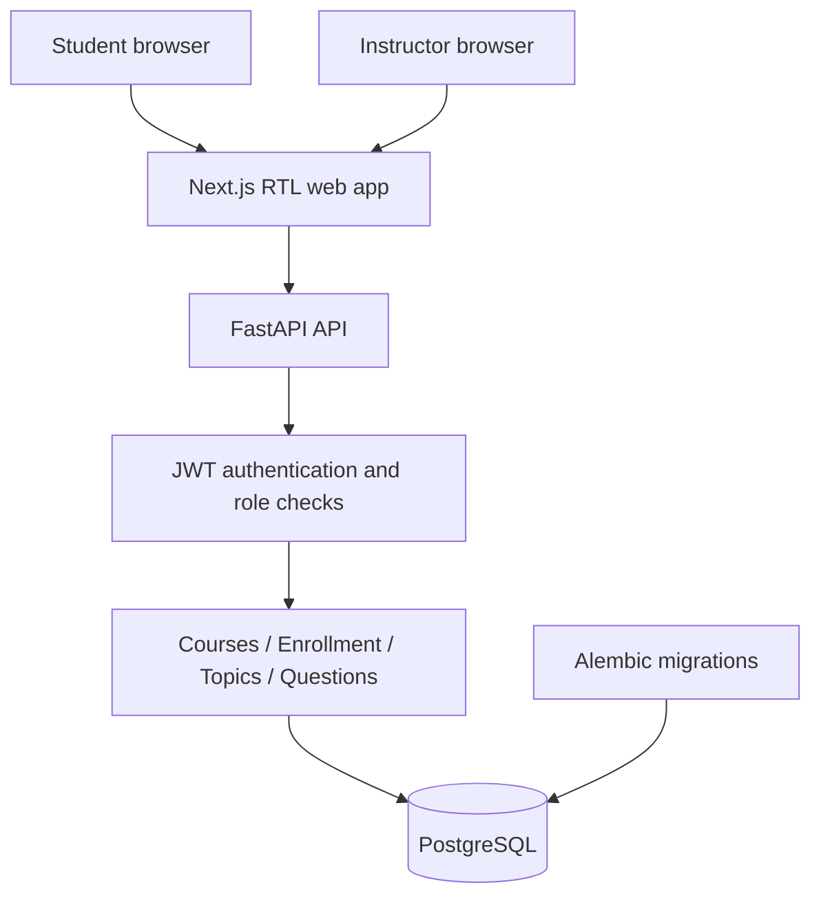

# Nabz Learning — Architecture Overview

**Status:** Phase 3  
**Architecture style:** Modular monolith  
**Pilot:** One instructor, one course, a small student cohort

## Product loop

1. An instructor creates a course and shares its enrollment code.
2. Students join using the code.
3. The instructor organizes content into topics.
4. The instructor creates topic-linked practice questions.
5. A later phase will assemble those questions into quizzes and return topic-level learning signals.

## System context

## Modules

- `frontend/`: Next.js App Router, TypeScript, Persian-first RTL presentation.
- `backend/app/api/auth.py`: registration, login, current-account endpoint.
- `backend/app/api/courses.py`: course management, enrollment, roster, and topics.
- `backend/app/api/questions.py`: course-scoped question-bank CRUD.
- `backend/app/api/course_access.py`: reusable ownership and enrollment checks.
- `backend/app/core/`: settings, JWT and password hashing.
- `backend/app/models/`: SQLAlchemy domain models.
- `backend/app/schemas/`: validated request and response schemas.
- `backend/app/cli.py`: trusted-terminal provisioning for instructor/admin accounts.
- `backend/alembic/versions/`: database migrations.

## Ownership and authorization

- Public registration creates student accounts only.
- Instructor accounts must be provisioned by a trusted operator using `python -m app.cli create-privileged-user`.
- An instructor can manage only their own courses; administrators can manage all courses.
- A student can view only courses in which they are enrolled.
- Enrollment requires a valid code for an active course; duplicate enrollment is rejected.
- Students cannot call the question-bank endpoints or receive answer keys from them.
- Single-choice questions require 2–6 options and exactly one marked correct option.

## Data model

- `users`: account, hash, role and active status.
- `courses`: instructor owner, title, term, description, active status and unique enrollment code.
- `enrollments`: course/student join table with a unique pair constraint.
- `course_topics`: course-specific learning topics, ordered by the instructor.
- `questions`: topic, prompt, explanation, difficulty and lifecycle status.
- `question_options`: options, position and answer key.

Migration `20261011_0002` adds course and question-bank tables after the users migration. Published questions are not directly exposed to students; quiz endpoints must later expose safe question DTOs without answer keys.

## API conventions

- All product routes use `/api/v1`.
- Health endpoint: `GET /api/v1/health`.
- Interactive API documentation: `/docs` in local development.
- Validate all input at the API boundary and enforce authorization in backend dependencies/service helpers, never solely in the frontend.
- Keep schemas explicit so answer keys cannot leak into student-facing payloads by accidental ORM serialization.

## Deferred

Quiz assembly, attempts, answer submissions, grading, topic-level learning analytics, email verification, password reset, token refresh, rate limits, audit records, institution SSO, and production privacy/security review are not implemented in this phase.
