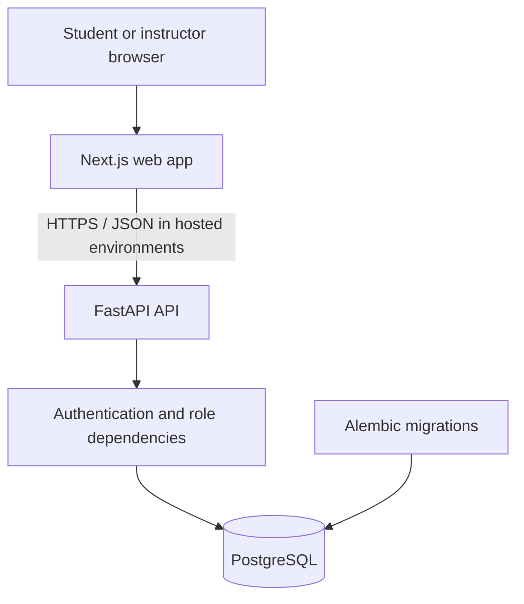

# Nabz Learning — Architecture Overview

**Status:** Phase 2 foundation  
**Architecture style:** Modular monolith  
**Primary pilot:** One instructor, one university course, a small student cohort

## Product boundary

The first useful product loop is intentionally narrow: an instructor prepares a practice quiz, students complete it, and the instructor gets an understandable summary of difficult topics. Rankings, opportunity matching, AI recommendations, and institution-wide administration are out of scope until the pilot validates the core value.

## System context

## Main modules

- `frontend/`: Next.js App Router, TypeScript, Persian-first RTL presentation.
- `backend/app/api/`: versioned HTTP routes, authentication and role dependencies.
- `backend/app/core/`: settings, JWT issuance/verification, password hashing.
- `backend/app/models/`: SQLAlchemy persistence models.
- `backend/app/schemas/`: validated request and response DTOs.
- `backend/app/db/`: SQLAlchemy base, engine, and session dependency.
- `backend/alembic/`: migration environment and revisions.
- `backend/tests/`: backend tests.
- `docs/adr/`: architecture decision records.

## API conventions

- Product API routes start with `/api/v1`.
- Health endpoint: `GET /api/v1/health`.
- Register: `POST /api/v1/auth/register` (student account only).
- Login: `POST /api/v1/auth/login` (returns a short-lived bearer JWT).
- Current account: `GET /api/v1/auth/me` (requires a valid bearer token).
- Local OpenAPI docs: `/docs`.

## Identity and role policy

The initial role set is `student`, `instructor`, and `admin`. Public registration assigns only `student`; the API rejects extra fields, including a submitted role. Instructor and admin provisioning must be introduced through a trusted workflow rather than self-service role selection.

Passwords are hashed using Argon2 through pwdlib. JWTs are signed with HS256, carry a subject, issuer, issue time and expiry, and have a configurable short lifetime. Protected routes use a shared dependency that resolves the account from the token and rejects invalid or disabled accounts. Route-specific authorization can use `require_roles(...)`.

This is a useful foundation, not a complete production identity service. Refresh tokens, password reset, email verification, login throttling, audit events, and formal admin provisioning are not implemented yet.

## Database

The first Alembic revision creates the `users` table with unique email, password hash, role constraint, active status, and creation timestamp. Docker Compose runs migrations on startup for local development. Production deployment should execute migrations as a controlled release step, not from every application replica.

## Configuration and secrets

Configuration comes from environment variables. `.env.example` documents local-only settings and `.env` is ignored by Git. Production mode rejects the example JWT key. Production still requires managed secrets, restricted network access, TLS, backups, monitoring, and a reviewed data-retention/privacy policy.

## Testing

Tests cover student registration, role-escalation rejection, login, token-protected profile access, duplicate email handling, invalid credentials/tokens, and the reusable role guard. Tests use an isolated in-memory SQLite database rather than a shared database.

## Deferred modules

Courses/enrollments, question bank and topic mapping, quizzes/attempts, grading, and instructor learning-gap reports remain later phases. Keep a modular monolith until the pilot demonstrates a concrete need for service separation.
