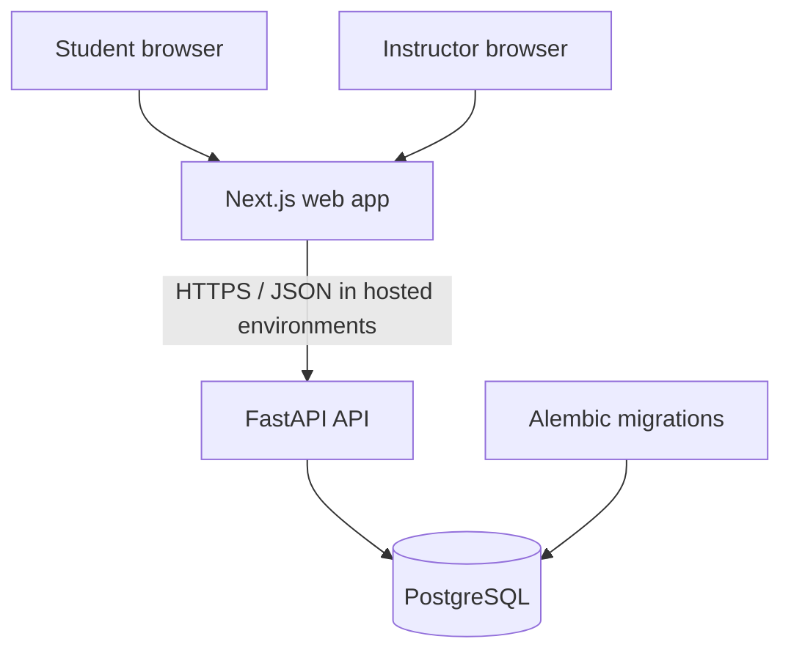

# Nabz Learning — Architecture Overview

**Status:** Phase 1 foundation  
**Architecture style:** Modular monolith  
**Primary pilot:** One instructor, one university course, a small student cohort

## Product boundary

The first useful product loop is intentionally narrow: an instructor prepares a practice quiz, students complete it, and the instructor gets an understandable summary of difficult topics. The product should not become a full LMS during the pilot. Public rankings, opportunity matching, AI recommendations, and institution-wide administration are out of scope.

## System context

## Repository structure

- `frontend/`: Next.js App Router, TypeScript, Persian-first RTL presentation.
- `backend/app/main.py`: API construction, CORS, versioned router.
- `backend/app/api/`: versioned HTTP routes.
- `backend/app/core/`: application settings.
- `backend/app/db/`: SQLAlchemy base, engine, and session dependency.
- `backend/alembic/`: migration environment and revision template.
- `backend/tests/`: backend tests.
- `docs/adr/`: architecture decision records.
- `.github/workflows/ci.yml`: automated checks.

## Technology decisions

| Concern | Choice | Rationale |
|---|---|---|
| Web | Next.js + TypeScript | Structured UI and type checking |
| API | FastAPI | Typed endpoints and generated OpenAPI |
| Settings | Pydantic Settings | Environment-based configuration |
| ORM | SQLAlchemy 2 | Explicit persistence and transactions |
| Database | PostgreSQL | Relational constraints and transactions |
| Migrations | Alembic | Versioned schema evolution |
| Local environment | Docker Compose | Reproducible services |
| CI | GitHub Actions | Automated checks |

See [ADR 0001](adr/0001-stack.md) for trade-offs.

## API conventions

- Product routes use the `/api/v1` prefix.
- Health endpoint: `GET /api/v1/health`.
- Local interactive docs: `/docs`.
- Add explicit request/response schemas as domain endpoints are introduced.
- Standardize errors, pagination, authorization, and audit requirements before wider rollout.

The health endpoint confirms that the API process responds; it does not prove PostgreSQL is reachable. Compose separately waits for the database health check before starting the API.

## Configuration and database

Configuration comes from environment variables. `.env.example` documents local settings and `.env` is ignored by Git. Compose credentials are development-only. Production requires managed secrets, restricted network access, TLS, backups, monitoring, and reviewed database permissions.

The SQLAlchemy base and Alembic environment are wired up, but Phase 1 defines no product tables and no domain migration. Add the first migration alongside the first persistent domain model; do not change an already-applied migration to represent a later schema state.

## Testing and future modules

CI runs backend lint/tests and frontend lint/typecheck/build. The current backend test covers the health route only, so it does not represent product readiness.

Likely later modules are identity/roles, courses/enrollments, question bank/topic mapping, quizzes/attempts/answers, deterministic grading, and instructor learning-gap reports. Use a modular monolith until pilot evidence justifies more services. Redis, Celery, and AI services are not justified by the current scope.
